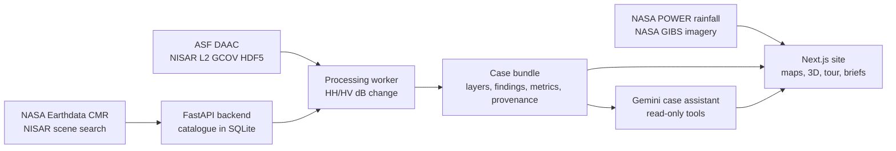

# CryoCore Horizon

### Seeing through the monsoon: NISAR radar turned into plain answers for Chattogram, Bangladesh

[](https://www.spaceappschallenge.org/2026/challenges/dancing-with-the-sars/)
[](https://www.spaceappschallenge.org/2026/challenges/dancing-with-the-sars/)
[](https://asf.alaska.edu/)
[](#who-it-is-for)
[](LICENSE)

**Challenge:** [Dancing with the SARs](https://www.spaceappschallenge.org/2026/challenges/dancing-with-the-sars/)
(NASA Space Apps Challenge 2026, Earth Science). **Team:** CryoCore Horizon, Bangladesh.

---

## In one paragraph

From June to October, monsoon cloud hides Chattogram from optical satellites, which is exactly when farmers and
officials most need to know what is happening on the ground. **CryoCore Horizon** uses L-band radar from the NASA–ISRO
**NISAR** mission, which sees through cloud, day or night, to measure how the lower Karnaphuli river, the port and the
farmland around them changed across one monsoon. It processes the real NISAR GCOV files and turns the backscatter
change into **plain, bilingual (English and Bangla) answers**: *what the radar saw, what it likely means, and what to
check next*. Every number carries its date, method and NASA source, and every reading is labelled *likely*, never
*confirmed*.

## Results at a glance

Processed from the real NISAR files (two GCOV granules, 6.1 GB and 6.3 GB), 19 June vs 17 October 2026, local time:

| Measure | Value |
| --- | --- |
| Area compared (valid on both dates) | **175.71 km²** (lower Karnaphuli river and Chattogram port) |
| Backscatter **increased** by ≥ 3 dB | **4.91 km²** |
| Backscatter **decreased** by ≥ 3 dB | **0.20 km²** |
| Change regions found | **92** (the 40 largest are listed with evidence) |
| Likely crop growth (HV rose ≥ 1.5 dB) | **4.54 km²** |
| Likely new water (HV fell to ≤ −19 dB) | **0.10 km²** |
| Orbit pair | Track 69, frame 13, ascending, HH + HV, same collection and product version |

## How we met the challenge objectives

| The challenge asks for | What CryoCore Horizon does |
| --- | --- |
| Use NISAR radar to track surface change | Downloads and processes real NISAR L2 GCOV HH/HV backscatter for a before/after pair; finds and classifies change regions |
| Pick a study area that matters to you | Chattogram, our home region: Bangladesh's main port, the Karnaphuli estuary and monsoon rice farmland |
| Interactive change maps, time series, dashboards | Mapbox change map, date-by-date radar reel, swipe comparison, 3D change columns, a live 3D Earth beside the NISAR spacecraft |
| Different polarizations | HH and HV are both used: HV for vegetation volume and water, HH for bright objects (ships, cranes, buildings) |
| Ancillary data for context | NASA POWER rainfall, MODIS/VIIRS optical imagery from the same morning, the official division boundary |
| Hypothesize the physical drivers | Each region gets a physical reading (crop growth, new water, objects) plus a documented list of confounders: tide, wet soil, wind, speckle, ships |
| Make NISAR accessible to a broad audience | Plain-language answers, a guided tour, a bilingual assistant, downloadable briefs |
| Open source, user friendly | MIT licence, works with no login and no backend (frozen snapshot), keyboard and screen-reader friendly |

## Who it is for

- **Farmers and agriculture officers:** where crops grew or were lost since the start of the monsoon, field by field.
- **Relief teams and local government:** where new water appeared, with a brief they can hand over.
- **Students, teachers and the public:** a guided tour that explains how radar sees through cloud, in English or Bangla.
- **Scientists:** granule IDs, checksums, thresholds, method version and exports (JSON, CSV, GeoJSON) for every result.

## Features

| Feature | What it does |
| --- | --- |
| **Sees through the monsoon** | A slider between a cloud-covered MODIS/VIIRS photo and NISAR radar from the same morning |
| **A plain answer for every field** | Tap anywhere: what the radar saw, what it likely means, what to do next |
| **Change in 3D** | Each change region rises from the map, coloured by its likely cause, height = size of the radar change |
| **Ask the map (English or Bangla)** | A case assistant answers from the case data, moves the map, switches layers and downloads the brief |
| **Guided tour** | A step-by-step story from cloud cover to radar change to action, for first-time users |
| **Compare dates** | Any two passes of the same orbit, with a check that the pair is fair to compare |
| **Evidence & brief** | Source of every picture, measured vs interpreted values, printable brief and JSON/CSV/GeoJSON downloads |
| **Scene catalogue** | Every NISAR scene over Chattogram Division from NASA CMR, searchable and openable on the map |
| **Honest by design** | Every reading says *likely*; excluded pixels are reported with every number; known limits are shown in the app |
| **Offline-safe** | A versioned snapshot replays the whole case without the backend, so the site never breaks |

## How it works



1. **Discover.** Search NASA Earthdata CMR for every NISAR scene over Chattogram Division and keep those that intersect
   the official boundary (181 GCOV records found in 2026, 128 intersecting).
2. **Pick a fair pair.** Group scenes into stacks (same track, frame, direction). Choose the widest-spaced dates that pass
   four checks: same geometry, same polarizations, same collection, same product version. This keeps processing changes
   from being mistaken for surface change.
3. **Process.** Read HH and HV from both GCOV files, apply the product's validity mask, reduce speckle, convert to dB,
   subtract, threshold at ±3 dB, group pixels into regions and drop small isolated ones.
4. **Interpret.** Classify each region with transparent HV/HH rules (`backend/app/processing/plain.py`):
   - HV rose by ≥ 1.5 dB → **likely crop growth** (more vegetation volume scattering, consistent with Aman rice)
   - HV fell from above to at or below −19 dB → **likely new water** (calm water is dark at L-band)
   - HH ≥ 3 dB on the brighter date → **object** (ships, cranes, containers, buildings: double bounce)
5. **Explain and share.** The site turns each region into a plain sentence with dates, size and source, and the brief
   packages it for an officer or relief team.

## NASA data used

| Dataset | Provider | How we use it |
| --- | --- | --- |
| **NISAR L2 GCOV** (`NISAR_L2_GCOV_PROVISIONAL_V1`, v1.0.11) | NASA–ISRO via ASF DAAC | **Core data.** HH and HV backscatter of the before/after pair; the change map and every finding |
| NISAR browse quicklooks | NASA–ISRO via ASF DAAC | The date-by-date radar reel and map overlays for every scene |
| NASA Earthdata CMR | NASA | Scene discovery, footprints, granule IDs, revisions and MD5 checksums |
| MODIS Terra and VIIRS (SNPP, NOAA-20) Corrected Reflectance | NASA GIBS | The cloud-covered optical view beside the radar, proving why radar is needed |
| Blue Marble Next Generation, VIIRS Black Marble | NASA GIBS | Day and night Earth textures for the 3D globe |
| NASA POWER daily precipitation (MERRA-2) | NASA LaRC | Monsoon rainfall at Chattogram to put each pass in context |
| NISAR GUNW, RSLC | NASA–ISRO via ASF DAAC | Indexed in the catalogue for future deformation and coherence work |

**Other sources:** Chattogram Division boundary from the Bangladesh Bureau of Statistics / HDX via geoBoundaries
(CC BY 3.0 IGO); basemap from Mapbox Standard.

**Exact granules used:**

| | Before | After |
| --- | --- | --- |
| Granule | `NISAR_L2_PR_GCOV_023_069_A_013_4005_DHDH_A_20260618T232102_…_001` | `NISAR_L2_PR_GCOV_033_069_A_013_4005_DHDH_A_20261016T232058_…_001` |
| CMR concept | `G4240317293-ASF` | `G4376150332-ASF` |
| Acquired (UTC) | 2026-06-18 23:21 | 2026-10-16 23:20 |

## Scientific integrity

We say only what the data can support: *between these dates, L-band backscatter over this area rose or fell by more
than 3 dB over this many km²*. That is **observed radar change**, not confirmed flooding or damage.

**Known confounders**, shown in the app and documented in [docs/curated-case.md](docs/curated-case.md):

- **Tide:** the Karnaphuli is macro-tidal; mudflats can be exposed on one pass and submerged on the other.
- **Wet soil:** monsoon soil moisture raises backscatter on its own.
- **Crop phenology:** Aman rice is planted in July–August and near maturity in October, which changes HV strongly.
- **Ships and cranes:** moored ships move between passes and look like point change on water.
- **Wind on water:** a rough river is not dark, which can hide water.
- **Speckle:** a single pixel's change is not evidence; we filter and drop small regions.
- **Provisional calibration:** both dates share one product version, so their *difference* is robust.

**Rejected alternatives** (and why) are recorded too: a quad-pol descending pair that did not match the default
comparison, pairs that mix product versions, and a stack whose footprints missed the study area.

## Reproducibility

- The exact windows of both NISAR files that processing reads are committed in
  [`backend/data/extracts/karnaphuli-estuary/`](backend/data/extracts/karnaphuli-estuary/) (2 × 9.7 MB, HH + HV + mask).
  `python -m app.cli prepare-case karnaphuli-estuary --from-extracts` reproduces the result **without the 12.4 GB
  download**.
- The processed case is frozen in [`public/data/chattogram/case/`](public/data/chattogram/case/), so the site replays
  the exact published result offline.
- Thresholds, rules and the method version travel with every finding and every export.
- Frontend and backend tests cover the API, the processing, the assistant, share links, the brief and the translation
  guard.

## Use of AI

| Tool | Where | What it does and does not do |
| --- | --- | --- |
| **Google Gemini** (`gemini-3.5-flash`, fallback `gemini-3.8-flash`) | In the product: the case assistant ([`backend/app/assistant.py`](backend/app/assistant.py)) | Answers questions in English or Bangla using function calls over **read-only** tools on the published case data. It can move the map, switch layers and start a download in the browser. It cannot change data, and it answers only from the case facts it reads |
| **AI coding assistants** | During development | Helped write and review code and documentation. The team chose the study area, the case, the method, the thresholds and every claim, and checked the results against the NASA source files |

No AI-generated images, video or data are presented as observations. Every map layer comes from NASA data or the
attributed sources above.

## Accessibility and language

- Full **English and Bangla** interface, switched in the header and remembered per browser; the page language is set
  before paint so screen readers use the right voice.
- Skip link, keyboard-operable controls and labelled landmarks.
- Respects *reduced motion*; light and dark themes that never recolour satellite imagery or scientific scales.
- Works without login, and without the backend.

## Run it locally

Requirements: Node.js 20+, pnpm, a public Mapbox token. Python 3.11+ only for the optional backend.

```bash
pnpm install
echo "NEXT_PUBLIC_MAPBOX_ACCESS_TOKEN=pk.your_public_token" > .env.local
pnpm dev                 # http://localhost:3000, uses the frozen case when no backend is running
```

Backend for live NASA search and processing: see [backend/README.md](backend/README.md).

| Command | What it does |
| --- | --- |
| `pnpm build` | Production build |
| `pnpm lint` · `pnpm test` | Lint and frontend tests |
| `pnpm freeze-case` | Refresh the frozen case snapshot (backend running) |
| `pnpm fetch-rain` | Refresh NASA POWER rainfall |

Set `NEXT_PUBLIC_CASE_SOURCE=frozen` to deploy without a backend.

## Tech stack

**Frontend:** Next.js 16, React 19, TypeScript, Mapbox GL JS (react-map-gl), three.js, Motion, Tailwind CSS.
**Backend:** Python, FastAPI, SQLite, h5py, NumPy, SciPy, rasterio, pyproj, Shapely, Pillow.
**AI:** Google Gemini API (function calling).

## Repository layout

| Path | Contents |
| --- | --- |
| [`src/app`](src/app) | Landing page (`/`) and the Chattogram case: overview, tour, explore, compare, evidence, catalogue, calibrated radar |
| [`src/components`](src/components) | Maps, globe, 3D views, radar steps, tour and assistant UI |
| [`backend/`](backend) | FastAPI API, NISAR processing worker, change classification, case assistant |
| [`public/data/chattogram/`](public/data/chattogram) | Frozen case snapshot and rainfall |
| [`docs/`](docs) | [Case study](docs/CHATTOGRAM.md) · [Curated case and method](docs/curated-case.md) · [Explorer notes](docs/EXPLORER.md) · [Mapbox setup](docs/MAPBOX.md) |

## What's next

- Add the quad-pol descending stack (`163_D_077`) for a second look geometry and VV/VH polarizations.
- Tide heights for both passes, and optical or field checks for each finding.
- A full monsoon time series across all 11 dates of the stack, not only one pair.
- InSAR (GUNW) for land subsidence around the port and the city.
- SMS or WhatsApp alerts in Bangla for agriculture officers.

## References and credits

- NISAR: NASA–ISRO, data distributed by the [Alaska Satellite Facility DAAC](https://asf.alaska.edu/).
- [NASA Earthdata CMR](https://cmr.earthdata.nasa.gov/) · [NASA GIBS](https://www.earthdata.nasa.gov/engage/open-data-services-software/earthdata-developer-portal/gibs-api) · [NASA POWER](https://power.larc.nasa.gov/)
- Boundary: [geoBoundaries](https://www.geoboundaries.org/) (Bangladesh Bureau of Statistics / HDX), CC BY 3.0 IGO.
- Basemap: [Mapbox](https://www.mapbox.com/).
- Open-source libraries listed under [Tech stack](#tech-stack), each under its own licence.

This is not an official NASA or ISRO website.

## License

Code: [MIT](LICENSE). Data keeps the licence of its source.
